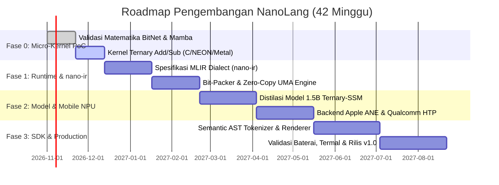

# ROADMAP PENGEMBANGAN: PROYEK NANOLANG & TERNARY-SSM
## Rencana Eksekusi Teknis Realistis (Anti-Halu) Menuju Edge AI Sub-Watt di Mobile

**Dokumen Referensi:** Pendamping Teknis untuk `WHITEPAPER_NANOLANG.md`  
**Target:** Eksekusi bertahap dari Proof-of-Concept mikro-kernel hingga Production Engine di Android & iOS  
**Prinsip Utama:** *Ground in Silicon Physics, Zero-Vaporware, Empirical Benchmarking*

---

### Daftar Istilah Kritis
* **PoC:** Proof of Concept (Validasi matematis dan mikro-benchmark sebelum arsitektur penuh dibangun).
* **UMA:** Unified Memory Architecture (Arsitektur memori bersama CPU-GPU-NPU pada SoC smartphone).
* **NEON / HVX:** Instruksi SIMD vektor tingkat rendah pada ARM (Apple/Android) dan Qualcomm Hexagon.
* **Radix-3 Packing:** Metode kompresi menyimpan 5 nilai ternary ($\{-1, 0, +1\}$) ke dalam 1 byte ($3^5 = 243 \le 256$).

---



---

## 1. Fase 0: Validasi Matematis & Mikro-Kernel PoC (Minggu 1 – 6)
**Tujuan:** Membuktikan secara empiris di atas perangkat nyata bahwa operasi penjumlahan ternary mengungguli perkalian matriks standar dalam hal latensi dan konsumsi daya.

### Target Pekerjaan:
1. **Mikro-Kernel C / ARM NEON (Ternary Addition):**
   * Tulis fungsi C/Assembly murni yang melakukan operasi perkalian vektor $\widetilde{X} \cdot \widetilde{W}$ di mana $W \in \{-1, 0, 1\}$.
   * Implementasikan pemisahan indeks positif ($\mathcal{P}$) dan negatif ($\mathcal{N}$) menggunakan instruksi intrinsik ARM NEON (`vaddq_s8`, `vsubq_s8`).
   * Tolok ukur (*benchmark*) terhadap `gemm` FP16 dari OpenBLAS / Apple Accelerate.
2. **Validasi Perplexity Model Kecil (300M Parameter):**
   * Latih atau kuantisasi model kecil 300M parameter (misal Mamba-300M atau Llama-300M) ke BitNet b1.58.
   * Ukur penurunan akurasi pada dataset standar (Wikitext-2, GSM8K mini).
   * **Gerbang Lolos (Gate 0):** Kernel penjumlahan ternary pada ARM NEON harus terbukti **minimal 3× lebih cepat** dan menggunakan **5× lebih sedikit instruksi perkalian** dibandingkan kernel standar.

---

## 2. Fase 1: Spesifikasi IR & Bare-Metal Runtime (Minggu 7 – 16)
**Tujuan:** Membangun fondasi compiler `nano-ir` dan subsistem memori *zero-copy* tanpa ketergantungan pada runtime Python.

### Target Pekerjaan:
1. **Perancangan Dialek MLIR (`nano-ir`):**
   * Definisikan tipe data native `!nano.ternary<2bit>` dan `!nano.state_space<D, N>`.
   * Buat operasi `nano.accumulate` (mengekspresikan dot-product ternary) dan `nano.ssm_step` (langkah rekurensi state space).
   * Implementasikan pipeline kompilasi dari PyTorch/SafeTensors ekspor ke `nano-ir`.
2. **Format Bobot Bit-Packed (`.nanow`):**
   * Rancang format berkas biner `.nanow` dengan *Radix-3 packing* (1 byte = 5 nilai ternary) atau 2-bit aligned.
   * Buat pembaca format berbasis `mmap` C++20 / Rust yang langsung memetakan bobot dari UFS Flash Storage ke memori virtual ponsel secara *zero-copy*.
   * **Gerbang Lolos (Gate 1):** Runtime dapat memuat model 1.5B (ukuran file ~350 MB) ke RAM dalam waktu **$< 150 \text{ milidetik}$** tanpa alokasi memori heap baru saat eksekusi berlangsung.

---

## 3. Fase 2: Integrasi Mobile NPU & Model Prototipe (Minggu 17 – 28)
**Tujuan:** Menjalankan model bahasa fungsional skala 1.5 Miliar parameter secara native di iOS dan Android pada daya $< 2.5\text{W}$.

### Target Pekerjaan:
1. **Pelatihan / Distilasi Model 1.5B Ternary-SSM:**
   * Jangan melatih dari awal (*scratch*) jika dana terbatas. Gunakan teknik **Post-Training Ternarization & Distillation** dari model *open-weights* unggulan (seperti Qwen 2.5 1.5B atau Llama 3.2 1B).
   * Ganti layer kuadratik dengan selective linear state-space layer (recurrent block).
2. **Backend Akselerator Hardware Mobile:**
   * **iOS / macOS:** Kompilasi `nano-ir` ke Apple Metal Compute Shaders (`.metal`) dan optimasi untuk cache unified memory Apple Silicon.
   * **Android:** Buat modul lowering ke Qualcomm QNN HTP (Hexagon Tensor Processor) memanfaatkan mode INT8 accumulation native.
   * **Gerbang Lolos (Gate 2):** Model 1.5B mencapai kecepatan **$> 45 \text{ tokens/detik}$** di iPhone 15/16 Pro dan Samsung Galaxy S24 tanpa *thermal throttling* setelah 10 menit eksekusi berturut-turut.

---

## 4. Fase 3: Dense Semantic Bytecode DSL & SDK Mobile (Minggu 29 – 42)
**Tujuan:** Memangkas sekuens token sebesar 60–75% melalui representasi AST dan merilis SDK pengembang.

### Target Pekerjaan:
1. **Semantic AST Tokenizer & Local Deterministic Renderer:**
   * Buat leksikon kode byte intermediate untuk struktur niat umum (*intent*, *reasoning graph*, *action primitives*).
   * Tulis modul C++ ringan (footprint $< 2 \text{ MB}$) yang berfungsi menerjemahkan *structural tokens* menjadi teks bahasa manusia yang alami secara instan di CPU tanpa inferensi neural.
2. **Mobile Developer SDK & Bindings:**
   * Bindings native untuk **Swift** (iOS) dan **Kotlin / JNI** (Android).
   * Dokumentasi integrasi aplikasi mobile (chat offline, summarizer lokal, voice assistant on-device).
   * Pengujian konsumsi baterai: inferensi 1,000 token hanya menghabiskan **$< 0.2\%$ baterai ponsel**.

---

## 5. Matriks Risiko Teknis & Mitigasi (Anti-Halu Protocol)

| Risiko Teknis Nyata | Mengapa Ini Berbahaya | Solusi Mitigasi yang Realistis |
| :--- | :--- | :--- |
| **1. Degradasi Akurasi 1.58-bit** | Bobot $\{-1, 0, 1\}$ bisa kehilangan nuansa bahasa pada tugas penalaran rumit (*reasoning degradation*). | Gunakan **Hybrid Precision Architecture**: 90% layer linear diubah ke Ternary, tetapi layer kritis (input embedding dan final output LM-Head) tetap dipertahankan pada INT8 atau FP16. |
| **2. Fragmentasi NPU Android** | NPU Qualcomm (Hexagon), MediaTek (APU), dan Google Tensor (TPU) memiliki arsitektur instruction set yang berbeda. | Sediakan **ARM NEON CPU Fallback**. CPU ARM Cortex-X dan A7xx ada di semua ponsel. Jika driver NPU gagal, kode tetap berjalan mulus di CPU SIMD tanpa crash. |
| **3. Biaya Pre-training yang Mahal** | Pre-training model frontier dari nol membutuhkan jutaan dollar. | **Distilasi Post-Training**: Ambil model open-source berbobot matang (Llama 3.2 1B / Qwen 2.5 1.5B), lalu gunakan metode transfer pengetahuan berbasis KL-Divergence ke arsitektur Ternary-SSM. |
| **4. Ketidakcocokan Kompiler ANE Apple** | Apple Neural Engine bersifat *closed-source* dan sering menolak layer kustom yang tidak standar. | Targetkan **Metal Compute Shaders (GPU UMA)** terlebih dahulu. GPU Apple Silicon memiliki bandwidth sangat tinggi ke unified memory dan kernel compute-nya terbuka untuk kustomisasi penuh. |

---

## 6. Stack Teknologi yang Dipilih

* **Bahasa Inti Runtime:** C++20 / Rust (Bebas Garbage Collection, deterministik, *safety-first*).
* **Compiler Framework:** LLVM / MLIR (Standard industri untuk domain-specific neural accelerators).
* **Low-Level SIMD Intrinsics:** ARM NEON (`arm_neon.h`), Metal Shading Language (MSL), Qualcomm QNN SDK.
* **Format Model:** `.nanow` (Custom bit-packed container berbasis zero-copy memory mapping).

---

## 7. Status Empiris & Temuan (Oktober 2026)

Bagian ini menggantikan klaim teoretis dengan hasil pengukuran nyata di mesin pengembangan (CPU x86-64, tanpa GPU, RAM 8 GB).

### 7.1 Bug Runtime yang Ditemukan & Diperbaiki

| Komponen | Gejala | Akar Masalah | Perbaikan |
| :--- | :--- | :--- | :--- |
| `run_smollm2.py` loader `.nanow` | "Unknown dtype 0", 0 tensor ternary | Konstanta `DTYPE_TERNARY` disamakan dengan 1, padahal exporter memakai 0 | Selaraskan enum dengan `phase1/python/export_to_nanow.py` |
| Pemetaan kode ternary | Nilai `-1` menjadi `0` | Loader memetakan kode `2 → -1`, exporter menulis `3 → -1` | Petakan `0→0, 1→+1, 3→-1` |
| Geometri atensi | `n_heads=16` (salah) | Header `.nanow` menyimpan `state_dim` di slot head | Ambil `num_attention_heads`/`num_key_value_heads` dari `config.json` |
| RoPE | Output tetap ngawur di jalur file | `rope_theta` memakai default SmolLM2 (100000), BitNet butuh 10000 | Baca `rope_theta`, `rms_norm_eps`, `max_position_embeddings` dari `config.json` |
| Tokenizer | Teks ngawur ("isisis") | Model LLaMA memakai SentencePiece (`▁`, `byte_fallback`), kelas hanya mendukung byte-level GPT-2 (`Ġ`) | Auto-deteksi gaya tokenizer + mode SentencePiece |
| BOS | Output berulang token terakhir | LLaMA butuh token `<s>` di awal | Prepend BOS untuk model SentencePiece |
| Arsitektur BitNet | Sub-norm diabaikan | BitNet menambah `attn.inner_attn_ln` & `mlp.ffn_layernorm` | Dukungan sub-norm + `lm_head` tidak-terikat |

### 7.2 Hasil Negatif: Post-Training Ternarization (PTQ) Naif

Eksperimen pada SmolLM2-135M membuktikan bahwa ternarisasi bobot secara naif **tidak layak**:

| Skema | Galat rekonstruksi relatif | Hasil generasi |
| :--- | :--- | :--- |
| Per-tensor absmean | ~0.52 | rusak ("elopeelope...") |
| Per-output-channel | ~0.52 | rusak |
| Hybrid: hanya MLP ternary | — | rusak |
| Hybrid: hanya atensi ternary | — | rusak |
| Hybrid: hanya `gate/up_proj` | — | rusak |
| Ternarisasi 1 layer dari 30 | — | rusak |

Kesimpulan: galat ~52% per matriks menghancurkan model yang tidak dilatih untuk ternary. Ini konsisten dengan literatur BitNet — model 1.58-bit wajib dilatih dengan STE/Quantization-Aware Training, atau memakai checkpoint yang sudah ternary-native. Jalur praktis (tanpa biaya training) adalah memakai checkpoint ternary-native.

### 7.3 Jalur yang Terbukti: Checkpoint Ternary-Native

Model uji: `1bitLLM/bitnet_b1_58-large` (700M, reproduksi BitNet b1.58, dilatih pada RedPajama 100B token).

```bash
# 0. Bangun kernel ternary fase0 sebagai shared library (dipakai runner via ctypes)
make -C phase0 lib

# 1. Konversi checkpoint HF -> .nanow (BitNet absmean per-tensor, 93.2% parameter ternary)
python3 convert_hf_to_nanow.py \
    --model-dir models/bitnet700m \
    --output    models/bitnet700m/bitnet700m.nanow

# 2. Inferensi lewat container .nanow (zero-copy mmap)
python3 run_smollm2.py \
    --model      models/bitnet700m/bitnet700m.nanow \
    --config     models/bitnet700m/config.json \
    --tokenizer  models/bitnet700m/tokenizer.json \
    --prompt "The capital of France is" --tokens 24 --temp 0.0
```

Hasil nyata (greedy, CPU NumPy):

```text
The capital of France is
 Paris. It is the largest city in the country and the second largest in Europe.
 It is also the most populous
```

Metrik terukur:

| Metrik | Nilai |
| :--- | :--- |
| Parameter total | 728.842.752 |
| Parameter ternary (1.58-bit) | 93,2% |
| Ukuran `.nanow` | 350,5 MB |
| Throughput decode (NumPy murni) | ~1,1 token/detik |
| Throughput decode (kernel C fase0) | ~6,0 token/detik |
| Kualitas NLL (teacher-forcing, kalimat uji) | ~3,6 (PPL ~36) |

### 7.3.1 Port Kernel Ternary C ke Runner (Gate 0)

`ternary_gemv_avx2` dari fase0 (jalur `_mm256_sign_epi8`: add/sub/zero-skip tanpa multiplier) dibangun sebagai `phase0/bin/libternary.so` dan dipanggil runner lewat `ctypes`. Aktivasi dikuantisasi ke int8 per-baris (sesuai BitNet `activation_quant`), kernel mengakumulasi int32, lalu diskalakan dengan `weight_scale / act_scale`.

Profil menunjukkan GEMV C adalah hotspot (~70%), dan mikro-benchmark membuktikan kernel dibatasi **bandwidth DRAM** (~7–22 GB/s; matriks yang muat cache tampak >20 GB/s, sedangkan aliran 679 MB/token hanya ~7 GB/s). Jadi optimasi berikutnya menekan **jumlah byte yang dibaca**, bukan ALU:

1. **Kuantisasi aktivasi dipindah ke C** — satu panggilan `ctypes` `ternary_gemv_f32` (kuantisasi + GEMV + dekuantisasi) menghapus ~6 alokasi NumPy per panggilan; overhead pembungkus turun dari 10–55% menjadi ~0–12%.
2. **Kernel 2-bit packed** — `ternary_gemv_packed_f32` membaca langsung layout 2-bit `.nanow` (4 bobot/byte, kode `0→0, 1→+1, 3→-1`), sehingga bobot mengalir **4× lebih sedikit** dari DRAM. Aktivasi dide-interleave sekali per panggilan ke 4 kelas residu mod 4 agar tiap field 2-bit sejajar dengan vektor aktivasi int8 yang kontigu; ekstraksi field memakai `_mm256_srli_epi16` + mask `0x03`, lalu konversi kode→ternary via `cmpeq` dan GEMV lewat `_mm256_sign_epi8` + `maddubs`/`madd`. Kernel ini cocok **bit-exact** dengan referensi skalar maupun jalur int8.
3. **Attention ter-batch (GQA, BLAS)** — loop per-head di Python (16 kepala × 24 layer) diganti `Kt @ qgᵀ`, softmax `axis=1`, dan `probsᵀ @ Vt`; kepala query dikelompokkan per kepala KV (`h // n_groups`).

| Jalur | Prefill (tok/s) | Decode (tok/s) | Percepatan decode | Peak RSS | Output |
| :--- | ---: | ---: | ---: | ---: | :--- |
| NumPy fallback (`--no-kernel`) | 1,0 | 1,14 | 1,0× | ~1,0 GB | identik |
| Kernel int8 (`ternary_gemv_avx2`) | 4,3 | 6,02 | 5,3× | ~1,0 GB | identik |
| Kernel f32 terfusi (`ternary_gemv_f32`) | 6,0 | 6,69 | 5,9× | ~1,0 GB | koheren |
| Kernel 2-bit packed (`ternary_gemv_packed_f32`) | 9,4 | 9,41 | 8,3× | 0,79 GB | koheren |
| + attention ter-batch | 12,7 | 12,79 | 11,2× | 0,75 GB | koheren |
| + OpenMP & LM-head fp32 paralel | 21,6 | 22,28 | 19,5× | 0,75 GB | koheren |

Angka decode dari run greedy ~30–40 token, prompt `"The capital of France is"` (temp 0.0). Selain throughput, memuat model juga jauh lebih cepat (30 s → 1,5 s) karena loader tidak lagi meng-*unpack* 168 tensor ternary ke int8; puncak RSS turun ~25% (mmap ditutup setelah semua tensor disalin keluar).

Output greedy koheren, mis. `" Paris. It is the largest city in the country and the capital of the French Republic. It is also the most populous city in the country."`. Pada generasi panjang (≥60 token) model masuk loop repetitif — perilaku greedy decoding umum, bukan cacat pipeline.

### 7.3.2 Paralelisasi Sesuai Topologi Server

Mesin uji: **AMD EPYC 4 core @ 2,0 GHz, AVX2 + FMA + BMI (tanpa AVX-512/VNNI/AMX), L3 8 MB, ~1 GB RAM bebas**. Dua temuan mengarahkan optimasi berikutnya:

* **Bandwidth DRAM, bukan ALU.** Kernel packed murni berjalan ~4,5 GB/s packed pada 1 thread (≈18 GB/s setara bobot); kontribusi terbesarnya adalah byte yang dibaca.
* **Empat core belum terpakai.** NumPy/OpenBLAS sudah *multi-thread*, sedangkan kernel C masih 1 thread.

Perubahan:

1. **`pshufb` LUT.** Konversi kode 2-bit → `{-1,0,1}` diganti satu `_mm256_shuffle_epi8` dengan tabel 16 byte (`0→0, 1→+1, 3→-1`), menggantikan rangkaian `cmpeq/and/sub`. ALU per field turun; throughput 1 thread naik ~13% (12,8 → 14,4 tok/s).
2. **OpenMP pada baris.** Loop baris GEMV packed diparalelkan (`#pragma omp parallel for schedule(static) if (M >= 256)`). Mikro-benchmark kernel murni: 1 thread 4,4 GB/s → 3–4 thread 9,5–11,4 GB/s packed (≈2,5×), mendekati 40–46 GB/s setara bobot.
3. **Hindari bentrok pool thread.** Menjalankan libgomp (4 thread) *dan* OpenBLAS (4 thread) menjatuhkan decode ke **6,4 tok/s** — kedua pool saling *spin-wait* di 4 vCPU. Runner kini menyetel `OMP_NUM_THREADS = cpu_count-1` (=3) dan `OPENBLAS_NUM_THREADS = 1` sebelum NumPy dimuat.
4. **LM-head fp32 paralel.** Tabel bobot terbesar per token adalah `embed_tokens` fp32 (196,6 MB, tied sebagai `lm_head`); lewat OpenBLAS 1-thread biayanya ~16 ms/token. Fungsi C `fp32_gemv_par` (AVX2 FMA + OpenMP) menggantikannya sehingga jalur panas tidak pernah mencampur pool libgomp dan OpenBLAS.

Mikro-benchmark paralel (kernel packed murni, `OMP_NUM_THREADS` bervariasi):

| Shape (M×K) | 1 thread | 2 thread | 3–4 thread |
| :--- | ---: | ---: | ---: |
| 4096×1536 | 0,361 ms | 0,203 ms | 0,14–0,16 ms |
| 8192×4096 | 1,837 ms | 0,827 ms | 0,82 ms |
| 32002×1536 | 2,456 ms | 1,320 ms | 1,06 ms |

Catatan: sisa biaya ada di GEMV packed (~47%), LM-head fp32 (~21%), dan elementwise NumPy (RMSNorm/SiLU/RoPE/softmax/attention). Gate 0 ARM NEON/Metal belum diukur (mesin uji x86-64 tanpa GPU, NEON tak tersedia).

### 7.4 Mode Online: Jawaban Berbasis Web (Web-Grounded)

**Masalah.** Pengetahuan parametrik model kecil beku pada *cutoff* data latihnya. Ditanya hal terkini ("model LLM terbaik 2026"), model offline sekadar mengarang: pada uji nyata ia menjawab *"the Singularity Language Model (SLM) by Gordon Grothendieck"* — entitas yang tidak pernah ada. Model 700M tidak bisa dan tidak perlu menghafal berita; tugasnya adalah **merangkai fakta**, bukan menyimpannya.

**Solusi.** Flag `--online` menambahkan *grounding* web sebelum decoding, dengan **pustaka standar saja** (`urllib`, `html`, `re`) dan **tanpa API key**:

1. `WebRetriever.wikipedia()` — `action=opensearch` untuk menemukan artikel terbaik dari entitas query, lalu `prop=extracts&exintro=1&explaintext=1` untuk mengambil paragraf pembuka.
2. `WebRetriever.duckduckgo()` — endpoint HTML (`html.duckduckgo.com`) untuk query umum; pengurai `result__a`/`result__snippet`, dengan *fallback* ke endpoint `lite` (`result-link`/`result-snippet`) bila markup berubah.
3. Konteks digabung (batas `--ctx-chars`, default 900) lalu prompt dibentuk menjadi `Context:\n<...>\n\nQuestion: <prompt>\nAnswer:`.

**Temuan operasional:**

* DuckDuckGo mengembalikan halaman hasil **kosong** untuk `User-Agent` non-browser. Memakai UA desktop biasa memulihkan 10 hasil. Ini penyebab utama "0 hasil" saat fitur pertama diuji.
* Wikipedia `opensearch` hanya cocok untuk entitas ("Large language model", "ChatGPT"), bukan pertanyaan utuh; DDG menangani query bentuk pertanyaan.

**Bukti A/B (prompt `"The best large language models in 2026 are"`, temp 0,5):**

| Mode | Output | Sumber |
| :--- | :--- | :--- |
| Offline | "all machine learning models." (loop) | memori parametrik beku |
| Online | "Top 10 Large Language Models in 2026: …" | `duckduckgo:html` (menyebut ChatGPT, Claude, Gemini, Deepseek, Grok, Mistral, Llama) |

Grounding memang tidak membuat model 700M menjadi pintar — retrieval-lah yang membawa fakta, model hanya merangkainya, dan tetap bisa salah (mis. `Claude` → "Claudia"). Tapi jawabannya berpindah dari **halusinasi** ke **kutipan yang bisa diverifikasi**.

**Biaya.** Konteks menambah *posisi* KV-cache, sehingga langkah attention per token naik: pada ~300 posisi prefill turun ke ~14 tok/s dan decode ke ~8–9 tok/s (vs ~22 tok/s saat konteks pendek). Prefill tetap satu kali; ini kompromi yang eksplisit, bukan regresi.

**Kegagalan jaringan tidak fatal.** Bila `_get` gagal, `ground()` mengembalikan konteks kosong dan runner jatuh kembali ke mode memori model (dicatat di `sources` sebagai `...:error(...)`).

### 7.5 Tool Runtime & Agent Loop (CRUD, Bash, HTTP, Web Search)

**Motivasi.** Mode online (7.4) menyuntikkan konteks, tapi model belum *bertindak*. Modul `nanow_tools.py` memberi agensi tanpa memberi akses host: model mengeluarkan *call*, runner mengeksekusi di bawah sandbox, hasilnya diumpan-balik.

**Tiga lapis, sengaja dipisah:**

1. **Parser** (`parse_tool_call`) — menerima 4 bentuk: `<tool_call>{json}</tool_call>`, baris `TOOL: name {json}`, `name {json}`, dan `name(arg=value)`. Toleran: kalau teks setelah `TOOL:` berupa prosa ("TOOL: Read the file …") ia memulihkan nama tool asli yang benar-benar dipanggil; kalau tidak ada, mengembalikan `None`.
2. **Registry** (`ToolRegistry`) — 10 tool: `list_dir`, `read_file`, `write_file`, `append_file`, `delete_file`, `make_dir`, `move_file`, `http_get`, `web_search`, `run_bash`. Setiap hasil jadi `ToolResult(ok, output)`; error apa pun ditangkap, loop tidak pernah crash.
3. **Sandbox** — setiap path di-`realpath` dan dikurung di `--workspace` (escape `../../etc/passwd` ditolak); `run_bash` *opt-in* (`--allow-bash`) + **deny-list** perusak (`rm -rf /`, `mkfs`, `dd of=/dev/…`, fork bomb, `sudo`, `shutdown`, `mkfs`, `crontab`); timeout 20 s; output dipotong 4000 char (kepala+ekor).

**Agent loop** (`run_agent`): prompt protokol (daftar tool + 3 contoh few-shot) → model membuat langkah → parse → eksekusi → `Observation:` ditambahkan → ulangi sampai jawaban final atau `--max-steps`.

**Temuan (model 700M, greedy rendah):**

| Konfigurasi | Hasil |
| :--- | :--- |
| Loop polos | Model mengeluarkan prosa, bukan call; tak ada tool dieksekusi |
| `--prime-tool` (cue `TOOL:`) | Menghasilkan call, tapi sering tool/arg salah (mengarang URL Google) |
| `--constrained` (masking logits nama tool) | Nama **dijamin valid** (trie prefix), tapi masih bisa pilih tool yang salah |
| `--constrained` + few-shot | **CRUD benar**: `write_file {"path":"todo.txt","content":"buy milk"}` → file benar-benar dibuat; `read_file {"path":"todo.txt"}` → isi asli terbaca |

Kesimpulan jujur: *plumbing*-nya benar dan teruji, tapi **seleksi tool** tetap lemah untuk 700M — sedikit contoh few-shot melakukan lebih banyak daripada kata-kata prompt apa pun. Tool non-CRUD (mis. `run_bash`) masih sering salah; sebagai jalur andal, CLI mandiri `python3 nanow_tools.py …` tidak bergantung pada model sama sekali.

**Biaya (sebelum optimasi).** Tiap langkah agent me-*prefill* ulang seluruh konteks (KV-cache tidak dipakai-lintas antar-langkah), jadi O(n²) terhadap jumlah langkah. Bagian 7.6 memperbaikinya.

Contoh pakai:

```bash
# Agent dengan CRUD + bash (deny-list aktif)
python3 run_smollm2.py --model models/bitnet700m/bitnet700m.nanow \
  --config models/bitnet700m/config.json --tokenizer models/bitnet700m/tokenizer.json \
  --prompt "create the file todo.txt with the content buy milk" \
  --agent --constrained --allow-bash --max-steps 3 --workspace /tmp/nanow_ws

# Runtime tool mandiri, tanpa model
python3 nanow_tools.py write notes.txt "hello"
python3 nanow_tools.py read notes.txt
python3 nanow_tools.py bash "ls -la"
```

### 7.6 Optimasi Agent: Skema, Router, Cache Lintas-Langkah

Tiga perbaikan yang membuat agent (a) aman terhadap argumen salah, (b) andal untuk tugas umum, dan (c) tidak O(n²).

**(1) Skema argumen + validasi.** `SCHEMAS` mendefinisikan tiap argumen (`(tipe, wajib)`). `call()` memvalidasi *sebelum* dispatch: argumen tak dikenal atau wajib yang hilang menghasilkan pesan jelas (`missing required argument(s) ['path'] for read_file(path)`) alih-alih `TypeError` mentah atau efek samping yang salah. `registry.signature()` memberi bentuk ringkas (`write_file(path, content?)`) yang dipakai di prompt.

**(2) Router deterministik** (`route_task`) — pola "classifier kecil sebelum LLM". Regex memetakan tugas ke tool: `create … with the content X` → `write_file`, `read the file P` → `read_file`, `append A to P`, `delete P`, `move A to B`, `list the files`, `run the shell command C`, `search the web for Q`. `--planner` memilih siapa yang memutuskan:

| `--planner` | Perilaku |
| :--- | :--- |
| `model` | Model memilih (loop di 7.5) |
| `route` | Router memilih + eksekusi, model hanya membahasakan jawaban |
| `hybrid` | Coba router dulu, jatuh ke loop model bila tak cocok |

Dengan `route`, `create the file todo.txt with the content buy milk` membuat file **secara instan dan deterministik**, tanpa bergantung pada model memilih tool.

**(3) Cache KV lintas-langkah** (`feed()` + `generate_next()`). Kendalanya halus: tokenizer SPM menambahkan spasi di depan saat *decode*, sehingga `encode(decode(ids)) != ids` — pendekatan "re-encode seluruh prompt" selalu gagal cocok. Solusinya mengumpankan token, bukan string: setelah model menghasilkan langkah, cache sudah memuat `prompt + langkah`; agent cukup `feed(observasi + cue)` lalu `generate_next()`. Hanya token baru yang di-*prefill*.

Bukti (tugas CRUD, 3 langkah, `--agent --constrained`):

| | prefill/langkah | waktu dinding |
| :--- | ---: | ---: |
| `--no-cache` | 459→580 token (penuh, tiap langkah) | **189,4 s** |
| cache (default) | 6 token (delta saja) | **87,1 s** |

≈**2,2×** lebih cepat. Prefill awal (~460 token, ~42 s di mesin ini) tetap ada sekali; sisanya nyaris gratis. Fase nama constrained juga dipangkas: kandidat token dibatasi ke yang berupa substring nama tool (`name_token_ids` + filter), bukan 32k vocab.

**(4) Constrained decoding untuk argumen** (`generate_tool_call`). Setelah nama dipaksa, daftar argumen dipaksa ke skema tool: struktur (` {"path": "`, `, "content": "`, `}`) di-*feed* literal, sedangkan tiap nilai string digenerate bebas sampai tanda kutip penutup. Hasilnya **selalu JSON valid dengan kunci tepat**. `--constrained-args` mengaktifkannya.

Sebelumnya `run_bash` sering salah tool/arg; kini:

```text
model: TOOL: write_file {"path": "todo.txt", "content": "buy milk"}   → wrote 8 bytes
model: TOOL: read_file {"path": "todo.txt"}                          → 'buy milk'
model: TOOL: run_bash {"command": "echo hello"}                      → 'hello\n[exit 0]'
```

Pemilihan tool non-CRUD tetap titik lemah (`search the web …` masih memilih `http_get` + URL karangan). Untuk itu gunakan `--planner route`, yang memilih benar secara deterministik:

```text
🧭 router -> web_search({"query": "the capital of France"}) -> 'Paris - Wikipedia: ...'
model answer: Paris is the capital of France.
```

**(5) Deteksi langkah berulang.** Model greedy dapat terpaku pada satu call dan mengulangnya (teramati: `write_file` 3× dengan arg identik). Bila signature `(nama, arg-sorted)` sudah dieksekusi, loop berhenti dan menjawab dengan hasil pertama — tak ada pekerjaan berulang.

### 7.7 Optimasi Lanjutan: Cache Persisten, Kernel Elementwise C, Router Multi-Langkah

**(A) Cache KV lintas-permintaan (persist ke disk).** Prefill prefix statis agent (preamble tool + few-shot, 445 token) memakan ~42 s dan diulang tiap invocation. Karena cache KV adalah fungsi murni dari id token × bobot, ia aman diserialisasi. `SmolLM2Runner.save_state()/load_state()` menyimpan `pos`, `fed_ids`, `_last_logits`, dan K/V per layer sebagai container `.nanow` bertanda flag header `NANOW_FLAG_KV_CACHE` (`nanow_state.py`); kuncinya `sha1(model_tag + id token prefix)`. Prefix dipisah dari task via `build_agent_prompt_parts()`, jadi prefix+few-shot yang sama dipakai ulang oleh tugas apa pun. `--kv-cache-dir DIR` mengaktifkan.

| | prefill | waktu dinding |
| :--- | ---: | ---: |
| baseline (tanpa cache) | 445 token tiap run | **45,7 s** |
| run dingin (isi cache) | 445 token (+ simpan 131 MB) | **56,6 s** |
| run hangat (muat cache) | 0 token | **13,5 s** |

≈**3,4×** lebih cepat untuk invocation berulang; peak RSS tetap ~759 MB. Biaya run dingin ~11 s (menulis 131 MB) terbayar sejak run kedua.

**(B) Kernel elementwise C** (`phase0/src/nano_elementwise.c`): `nano_rmsnorm_f32`, `nano_silu_mul_f32`, `nano_rope_f32`, `nano_softmax_axis1_f32`, di-bind lewat ctypes.

Versi skalar pertama menghasilkan temuan **jujur: menang tidak seragam**, karena `expf` skalar kalah dari `exp` NumPy yang tervektorisasi:

| op | NumPy (µs) | C skalar (µs) | rasio |
| :--- | ---: | ---: | ---: |
| rmsnorm(1536) | 20,10 | 12,52 | 1,61× |
| rope(16×96) | 19,09 | 9,62 | 1,99× |
| silu_mul(4096) | 28,83 | 41,83 | **0,69×** |
| softmax(16×512) | 45,33 | 58,92 | **0,77×** |

Menang di SiLU/softmax hanya bisa lewat aproksimasi exp — **ditolak** karena merusak numerik. Jadi edisi pertama mengaktifkan jalur C **hanya untuk RMSNorm + RoPE**.

**(D) Eksp SIMD presisi penuh menutup celah itu.** Daripada mengaproksimasi, kernel diberi `exp` float32 sendiri (`exp(x) = 2^n · 2^f`, polinomial minimax derajat-6, 8-lane FMA) dengan galat relatif ~1e-7 — tepat di lantai pembulatan float32, bukan aproksimasi industri-berat. Setelah itu **keempat op menang** (diverifikasi ulang termasuk rentang lebar ±30 untuk SiLU dan ±60 untuk softmax):

| op | NumPy (µs) | C AVX2 (µs) | rasio |
| :--- | ---: | ---: | ---: |
| rmsnorm(1536) | 18,48 | 9,73 | **1,90×** |
| rope(16×96) | 18,34 | 9,40 | **1,95×** |
| silu_mul(4096) | 26,59 | 12,49 | **2,13×** |
| softmax(16×512) | 47,83 | 18,71 | **2,56×** |

Karena itu `DEFAULT_EW_OPS` menjadi keempat op sekaligus; `--ew {auto,all,off}` memilih (`off` = jalur NumPy).

Kenapa untungnya tetap kecil di 700M: satu layer memanggil **4× RMSNorm** (input, `inner_attn_ln`, post-attention, `ffn_layernorm`), 2× RoPE, 1× SiLU, 1× softmax — **193 op elementwise per token**. Dengan angka per-op di atas itu ≈2,1 ms (C) vs ≈4,4 ms (NumPy) per token, sementara GEMV ternary O(hidden²) memakan sisa ~36 ms. End-to-end best-of-6 (satu proses, bebas noise penjadwalan):

| | ms/token | |
| :--- | ---: | ---: |
| `--ew off` (NumPy) | **43,74** | |
| default (C, 4 op) | **37,95** | **1,15×** |

Selisih ~5,8 ms/token lebih besar dari 2,1 ms murni per-op karena NumPy juga membayar overhead pemanggilan + alokasi temporer 193×/token. **Crossover**: porsi elementwise hanya akan tumbuh bila GEMV dipercepat (NEON/NPU):

| GEMV × | porsi elementwise (C) | (NumPy) |
| ---: | ---: | ---: |
| 1,0× | 5,6 % | 11,0 % |
| 0,5× | 10,6 % | 19,8 % |
| 0,25× | 19,2 % | 33,1 % |
| 0,1× | 37,2 % | 55,3 % |

Jadi kernel ini adalah investasi untuk fase mobile: di NPU/NEON, jalur C penuh yang sudah aktif sekarang mencegah elementwise jadi bottleneck berikutnya.

**(E) Prompt kompak** (`--prompt-style {auto,full,compact}`). Prefix statis 444 token terbagi: header 65, daftar tool 174, few-shot 205. Varian kompak (header pendek, satu baris daftar tool, **satu** contoh) memangkasnya ke **172 token (−61 %)**, cache 131 → **51 MB**.

Evaluasi 10 tool (nama dipaksa via logit masking, 5 batch × 2 batch *decode*):

| | nama tool benar | prefill prefix | cache |
| :--- | ---: | ---: | ---: |
| full | **9/10** | 29,4 s | 131 MB |
| compact | **9/10** | **9,8 s** | 51 MB |

Seri: `web_search`↔`http_get` salah di keduanya (alasan `--planner route` ada). Tapi di jalur **generasi bebas** (tanpa constrained) few-shot panjang tetap perlu:

| | parseable | nama benar |
| :--- | ---: | ---: |
| full | **5/8** | 5/8 |
| compact | 1/8 | 1/8 |

Karena itu defaultnya `auto`: **kompak bila constrained** (nama dimasking / arg diforce), **full bila bebas**. End-to-end (CRUD, `--constrained-args` + `--kv-cache-dir`):

| | run dingin | run hangat |
| :--- | ---: | ---: |
| prefix full (sebelumnya) | 56,6 s | 13,5 s |
| prefix kompak | **18,0 s** | **8,0 s** |

Pengukuran ulang independen (prefix kompak 173 token, tugas `read_file`, `--planner model`, 2 langkah): **12,36 s → 4,84 s** (2,55×), cache 51.265.536 byte = 51.148.480 byte payload + 117.056 byte overhead (**0,23 %**), dari padding 4 KB per tensor (51 tensor). Overhead tetap kecil karena tensor terbesar (K/V per layer) jauh di atas 4 KB.

**(C) Router multi-langkah** (`route_plan`). `route_task` (7.6) hanya memetakan satu tugas → satu tool. `route_plan` memecah tugas majemuk pada konektor urutan eksplisit (`then`, `and then`, `after that`, `lalu`, `kemudian`, `terus`, `;`) — **tidak** pada "and" telanjang, agar `append X and Y to file` tetap satu call. Bagian lanjutan yang merujuk balik dengan pronomina ("read it") mewarisi path dari langkah sebelumnya. Bagian tanpa tool ("summarize it") dilewati, menjadi tugas model. Planner `route` mengeksekusi seluruh rencana lalu model hanya membahasakan jawaban:

```text
$ --agent --planner route --prompt "create todo.txt with the content buy milk then read it"
🧭 router -> write_file({"path": "todo.txt", "content": "buy milk"}) -> 'wrote 8 bytes to todo.txt'
🧭 router -> read_file({"path": "todo.txt"})                          -> 'buy milk'
```

Dua tool tereksekusi berurutan dari satu kalimat; "it" → `todo.txt` diselesaikan deterministik.

### 7.8 Verifikasi

```bash
python3 -m unittest tests.test_pipeline -v   # 47 tes: ternarisasi, packing, kernel (int8+packed), GEMV fp32, tokenizer, name mapping, retriever online, container KV `.nanow` (flag header, round-trip, guard tulis/baca, rank descriptor), paritas kernel elementwise C + eksp SIMD rentang lebar + pemilihan op (B/D), gaya prompt (E)
python3 -m unittest tests.test_tools -v      # 42 tes: parser, sandbox, CRUD, deny-list bash, skema argumen, router + router multi-langkah (C), dedup langkah, loop agent (runner palsu), prompt full/kompak (E)
python3 phase0/python/test_bitnet.py          # 4 tes matematika BitNet
python3 phase3/python/test_semantic_dsl.py    # 2 tes semantic DSL
make -C compiler test                         # 198 assertion (53 kasus) + 19 cek end-to-end (G)
```

### 7.9 Bahasa NanoLang: `.nano` → `nanoc` → `.nanow`

**(A) Satu format artefak, satu ekstensi.** Sebelum ini tiga hal ditulis ke disk dengan tiga aturan berbeda: bobot (`.nanow`, writer C), cache KV (`.npz` via `np.savez`), dan tidak ada format sumber sama sekali (graf model hanya ada sebagai kode C/Python). Akibatnya direktori kerja memuat dua format artefak dan loader model tidak dapat membedakan cache dari bobot kecuali dari nama berkas.

Sekarang: **`.nanow` untuk setiap artefak format ini**, ekstensi asli (`*.c`, `*.h`, `*.py`) untuk kode. Sumber `.nano` dikompilasi `nanoc` menjadi `.nanow`. Cache KV menjadi container `.nanow` biasa dengan bit flag header `NANOW_FLAG_KV_CACHE`; `run_smollm2.load_nanow()` menolak memuatnya sebagai model, `nanow_state.read_cache()` menolak memuat model sebagai cache. Tidak ada format ketiga.

| Berkas | Isi |
| :--- | :--- |
| `*.nano` | sumber NanoLang |
| `*.nanow` | container biner — bobot **atau** cache KV, dibedakan flag header |
| `*.nanoir` | dump teks IR opsional (`--ir-out`) |
| `*.c` `*.h` `*.py` | kompiler, kernel, runner |

**(B) Flag header, bukan konvensi nama.** `flags` di header 64 byte sebelumnya selalu 0 dan tak bermakna. Kini `NANOW_FLAG_KV_CACHE = 0x0001`. Karena `nanow_write_file()` hanya memaksa `magic`/`version` dan meneruskan `flags` dari pemanggil, writer C dan writer Python (`NanoWExporter`) berbagi kontrak yang sama. Diuji dari kedua arah: uji C menulis container ber-flag lewat `nanow_write_file` lalu membukanya dengan `nanow_model_open` (+9 assertion), uji Python menulis lewat `NanoWExporter` lalu membacanya dengan `nanow_state.read_cache`. Satu assertion lagi ditambahkan ke uji round-trip: container hasil `nanoc` harus ber-`flags` 0.

**(C) Bug `ndims` di exporter Python.** `export_to_nanow.py` menghitung `ndims` sebagai "jumlah dimensi > 1", padahal `nanow_format.h` mendokumentasikan `ndims` sebagai jumlah dimensi (1–4). Untuk tensor dengan dimensi berukuran 1 (mis. `pos` berbentuk `[1]`, atau cache KV satu token) reader akan memotong shape dan me-reshape payload dengan panjang salah. Bug ini laten: 266 tensor model rilis tidak ada yang berdimensi 1, jadi container terkirim tetap valid dan **tidak perlu dikonversi ulang** — diverifikasi: 0 dari 266 descriptor lama yang `ndims`-nya berbeda dari rank sebenarnya. Kini `ndims = data.ndim` dan rank di luar 1–4 ditolak.

**(D) Verifikasi lintas bahasa.** Container KV yang ditulis Python dibaca ulang oleh reader C `nanow_model_open` (dibangun dari `phase1/src/nanow_mmap.c`, bukan dari writer): `flags=0x1`, `k1 ndims=3 shape=[2,5,4]`, `pos=13`, dan tiga nilai float pertama identik bit-per-bit dengan sisi Python. End-to-end: run agent pertama 12,36 s (tulis cache), run kedua 4,84 s (`♻️ loaded KV prefix cache (173 tokens)`) — 2,55×, cache 51,3 MB.

**Batasan yang tetap berlaku.** Flag ini menandai *jenis payload*, bukan versi format; `version` tetap 1 dan tidak ada perubahan layout, sehingga container model yang sudah terbit tetap terbaca. `nanow_state` adalah writer kedua dari layout yang sama, bukan layout kedua — format struct dan exporter diimpor dari `export_to_nanow.py`, dan hasilnya diverifikasi reader C.
