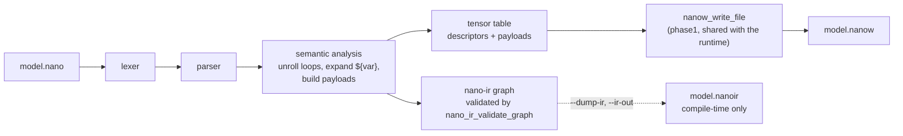

# NanoLang

NanoLang is a small declarative language for describing a model and the binary
container it lives in. Source files use the `.nano` extension. The `nanoc`
compiler turns one into a `.nanow` container that the existing runtime already
loads:

```text
model.nano  --[nanoc]-->  model.nanow  --[phase1 reader / run_smollm2.py]-->  runnable
```

It replaces writing a Python exporter script per model with a checked, loopable,
reproducible description. It is deliberately not a language the runtime
executes — see [Scope](#scope-what-this-is-and-is-not) before expecting more.

---

## Quick start

```bash
make -C compiler                       # builds compiler/build/nanoc
compiler/build/nanoc compiler/examples/tiny_lm.nano -o /tmp/tiny_lm.nanow --print-manifest
```

```console
$ compiler/build/nanoc compiler/examples/tiny_lm.nano -o /tmp/tiny_lm.nanow --print-manifest
model: layers=2 hidden=64 state=0 vocab=128
tensors: 9   total_params: 32960
name                                     dtype    pack   shape                elements      bytes
embed_tokens                             fp32     raw    128x64                   8192      32768
layers.0.w_in                            ternary  2bit   64x64                    4096       1024
layers.0.w_out                           ternary  2bit   64x64                    4096       1024
layers.0.norm                            fp32     raw    64                         64        256
layers.1.w_in                            ternary  2bit   64x64                    4096       1024
layers.1.w_out                           ternary  2bit   64x64                    4096       1024
layers.1.norm                            fp32     raw    64                         64        256
final_norm                               fp32     raw    64                         64        256
lm_head                                  ternary  2bit   128x64                   8192       2048
payload total: 39680 bytes (before page alignment)
nanoc: compiler/examples/tiny_lm.nano -> /tmp/tiny_lm.nanow (9 tensors, 32960 params, 69632 bytes)
```

The result is an ordinary `.nanow` file. Nothing downstream needs to know NanoLang
exists.

---

## Extensions

The rule is: real extensions for things that are code, `.nanow` for things that
are artifacts of this format.

| File                | What it is                                     | Why that extension                      |
|---------------------|------------------------------------------------|-----------------------------------------|
| `*.nano`            | NanoLang source                                | real language, so a real source extension |
| `*.nanow`           | binary container (weights + directory)         | the container format itself             |
| `*.nanoir`          | optional IR text dump (`--ir-out`)             | a text artifact of the compiler         |
| `*.c` `*.h` `*.py`  | the compiler, the kernel, the runner           | C is compiled by a C compiler; renaming these to `.nanow` would stop `gcc`, `make` and every editor recognising them |

Renaming the C sources to `.nanow` was considered and rejected: `gcc -c x.nanow`
silently produces nothing because the extension no longer selects the language,
so the build would break in a way that looks like a missing file.

---

## Scope: what this is and is not

**That is:** a description language for model topology and tensor payloads, with
semantic checks, that emits a container the existing runtime loads.

**That is not:** a language executed at run time. The runtime reads the `.nanow`
container. It never parses, imports or evaluates a `.nano` file.

The IR graph is a compile-time artifact. `op` statements are lowered into
phase1's `nano_ir_graph_t`, validated by `nano_ir_validate_graph()`, and dumped
on request — but the container has no opcode table, so the graph is not stored in
it and the runtime does not read it. This is stated plainly because the opposite
was claimed elsewhere in this repository for a while: before this compiler, no
code imported `nano_ir` at all. Now the compiler does, as a checking pass.

---

## The language

### Grammar

```text
program   := statement*
statement := model | tensor | op | for | emit
model     := "model"  name  "{" field* "}"
tensor    := "tensor" name  "{" field* "}"
op        := "op" ident name "{" field* "}"
for       := "for" ident "in" NUMBER ".." NUMBER "{" statement* "}"
emit      := "emit" STRING
field     := IDENT "=" value
value     := NUMBER | STRING | IDENT | "[" NUMBER ("," NUMBER)* "]"
name      := IDENT | STRING
```

Lexical notes:

- Line comments start with `//`, block comments are `/* ... */`. Block comments
  may span lines.
- Identifiers match `[A-Za-z_][A-Za-z0-9_.]*`; dots are allowed so that
  `layers.0.in_proj` needs no quotes.
- `0..4` lexes as the number `0`, the range operator `..`, the number `4`.
- Strings are double-quoted, may not contain a raw newline, and decode `\"`,
  `\\`, `\n`, `\t`, `\$`. `${...}` is preserved verbatim for the semantic pass.
- A quoted name may contain `${var}`; a loop variable is substituted when the
  loop is unrolled.

### `model`

Exactly one is required. It fills the container header.

| Field    | Type | Required | Meaning                                     |
|----------|------|----------|---------------------------------------------|
| `layers` | int  | yes      | Number of layers; must be > 0               |
| `hidden` | int  | yes      | Hidden dimension; must be > 0               |
| `state`  | int  | no       | Recurrent state dimension (SSM); default 0  |
| `vocab`  | int  | no       | Vocabulary size; default 0                  |

### `tensor`

Declares one tensor: its descriptor and its payload.

| Field     | Type    | Required            | Meaning                                       |
|-----------|---------|---------------------|-----------------------------------------------|
| `dtype`   | ident   | yes                 | `ternary`, `int8`, `fp16` or `fp32`           |
| `shape`   | `[...]` | yes                 | 1 to 4 dimensions, each > 0                   |
| `init`    | ident   | yes                 | `zeros`, `ones`, `ramp`, `ternary` or `from`  |
| `packing` | ident   | no                  | `2bit` (default for ternary), `radix3`, `raw` |
| `scale`   | number  | for ternary         | Dequantisation scale; must be > 0             |
| `seed`    | int     | no                  | Only with `init = ternary`                     |
| `source`  | string  | with `init = from`  | Path to a raw payload (see below)               |

A tensor name is stored in 64 bytes, so it must be at most 63 characters; the
compiler rejects longer names rather than truncating them.

### Initialisers

| `init`    | Applies to        | Produces                                              |
|-----------|-------------------|-------------------------------------------------------|
| `zeros`   | any dtype         | All zeros                                             |
| `ones`    | any dtype         | All ones (fp16 ones are encoded as `0x3C00`)          |
| `ramp`    | `fp32`, `fp16`    | `i / (n - 1)`, so the first element is 0 and the last is 1 |
| `ternary` | `ternary` only    | A deterministic sequence over `{-1, 0, +1}`, 2-bit packed |
| `from`    | any dtype         | Exactly `data_size` bytes read from `source`          |

`init = ternary` is seeded from the tensor name, so identical declarations in
different loop iterations still produce different weights:

```text
tensor "layers.${l}.w" { dtype = ternary shape = [64,64] scale = 0.02 init = ternary }
```

gives `layers.0.w` and `layers.1.w` different data without any extra syntax. An
explicit `seed` overrides that and makes the name irrelevant. The generator is an
LCG — reproducible, not cryptographic.

`init = from` reads exactly the expected number of bytes. A file that is too
short or too long is an error, because a silently truncated weight matrix corrupts
results far from the cause.

The file is raw little-endian data, conventionally `*.bin`, and *not* a `.nanow`
container. It is an input to the compiler, not an artefact of this format: bytes
handed to the compiler are by definition not yet in the format the compiler
produces. Reading a tensor back out of a container would need a different field
and is not supported.

### `op`

Lowers into the compile-time IR graph. Opcodes match `nano_ir_opcode_t` exactly.

| Opcode             | Fields besides the required ones |
|--------------------|----------------------------------|
| `embedding_lookup` | —                                |
| `rmsnorm`          | —                                |
| `ternary_linear`   | `weight` (required)              |
| `ssm_step`         | —                                |
| `silu_mul`         | —                                |
| `residual_add`     | —                                |

| Field    | Type   | Required | Meaning                                      |
|----------|--------|----------|----------------------------------------------|
| `in`     | int    | yes      | Input dimension                              |
| `out`    | int    | yes      | Output dimension                             |
| `scale`  | number | no       | Node scale; default 1.0                      |
| `weight` | string | `ternary_linear` | Name of the ternary weight tensor     |

`weight` is what makes the graph more than documentation. The compiler requires
that the named tensor exists, is ternary, is 2-D, and has shape `[out, in]`
matching the op's dimensions — so a graph and its data cannot silently disagree.

### `for`

`for v in LO..HI { ... }` unrolls `HI - LO` times with `v` bound to
`LO, LO+1, ... HI-1`. The range is half-open. Loops nest up to 8 deep and unroll
at most 65536 times.

### `emit`

`emit "path"` records the default output path. `-o` on the command line wins; if
neither is given the source name with `.nanow` substituted is used. If several
`emit` statements appear, the last wins and the compiler says so.

---

## What the compiler checks

Errors, by category. Every one of these has a test in `tests/test_nanoc.c`.

| Category      | Checked                                                                 |
|---------------|-------------------------------------------------------------------------|
| Lexical       | unterminated string, unterminated block comment, unexpected character, oversized literal |
| Syntactic     | missing `=`, stray `}`, missing statement, non-integer loop bounds, oversized field/opcode/loop name |
| Names         | duplicate tensor, empty name, name longer than 63 characters, unterminated or empty `${}`, unbound `${var}`, oversized emitted name |
| Fields        | unknown field, duplicate field, wrong value type, required field missing |
| Shapes        | zero or negative dimension, more than 4 dimensions, `hidden` over 1048576 |
| Ternary       | missing `scale`, non-positive `scale`, `init` not `ternary`/`from`, `seed` with another `init` |
| Files         | `from` without `source`, `source` without `init = from`, unreadable file, wrong file size |
| Graph         | unknown opcode, non-positive dimensions, `ternary_linear` without `weight`, weight not a declared tensor, weight not ternary, weight not 2-D, weight shape mismatch, `ssm_step` dimension mismatch, oversized node name |
| Budget        | total payload over `--max-bytes` (default 512 MB)                       |
| Structure     | no `model` block, no tensors declared, duplicate `model` block          |

Warnings: an unreadable dtype or packing that `--allow-unreadable` permitted, and
more than one `emit`.

### Runtime-compatibility gates

The container format defines dtypes and packings that no reader in this repository
can fully decode. Emitting them by default would produce a file that only partly
loads, so the compiler refuses, and `--allow-unreadable` downgrades the refusal to
a warning:

| Declared                    | Why it is gated                                                                 |
|-----------------------------|---------------------------------------------------------------------------------|
| `dtype = fp16` / `int8`     | `run_smollm2.load_nanow` decodes only ternary and fp32, and prints `[WARN] Unknown dtype N ... skipping`. Measured, not assumed. |
| `packing = radix3`          | `pack_ternary_radix3()` exists in phase1, but nothing anywhere unpacks it.       |
| `packing = raw` (ternary)   | One ternary value per byte; the runtime expects 2-bit packed ternary.            |

The C reader in `phase1/src/nanow_mmap.c` is dtype-agnostic — it maps bytes and
looks tensors up by name — so this gate is about the Python runtime specifically.

---

## Irreproducibility and determinism

Two compiles of the same source produce byte-identical containers, and
`tests/run_examples.sh` asserts it with `cmp`. Three things make that true:

- `init = ternary` uses a fixed LCG seeded from the tensor name
- payloads are page-padded by the shared writer, not by the compiler
- no timestamps, absolute paths or padding bytes depend on the environment

---

## CLI

```text
usage: nanoc <source.nano> [options]

  -o, --output PATH     write the .nanow container to PATH
                        (default: `emit` in the source, else <source>.nanow)
      --dump-ir         print the nano-ir graph to stdout
      --ir-out PATH     also write the nano-ir graph to PATH
      --print-manifest  print the compiled tensor table to stderr
      --from-dir DIR    base directory for `from "..."` sources
      --max-bytes N     payload allocation guard (default 536870912)
      --allow-unreadable
                        downgrade "no reader can decode this" from an
                        error to a warning
  -h, --help            show this message
  -v, --version         show the compiler version
```

Human-facing output goes to stderr, so `--dump-ir` alone on stdout:

```bash
nanoc model.nano --dump-ir > model.nanoir
```

Exit codes: `0` success, `1` the source failed to compile, `2` usage error,
`3` the output could not be written.

---

## Pipeline



Source layout:

```text
compiler/
  include/nano_lang.h    tokens, AST, diagnostics, compile/emit API
  src/nano_lexer.c       tokeniser + diagnostics
  src/nano_parser.c      recursive-descent parser -> AST
  src/nano_sema.c        loop unrolling, ${var} expansion, checks, IR lowering
  src/nano_codegen.c     -> .nanow via phase1's nanow_write_file
  src/nano_driver.c      file -> lex -> parse -> sema
  tools/nanoc.c          command line
  examples/*.nano        tiny_lm, demo_ssm
  tests/test_nanoc.c     198 assertions over 53 cases
  tests/run_examples.sh  end-to-end, incl. the Python reader
  tests/verify_nanow.py  decodes containers with run_smollm2.load_nanow
```

The compiler has one writer and one IR, both borrowed from phase1. Nothing in
`compiler/` re-implements the container layout, so the format cannot drift between
the compiler and the runtime.

Dependencies: C11 and the C standard library. `nano_codegen.c` uses `dup`/`dup2`
from POSIX to redirect stdout while reusing `nano_ir_dump_text()`'s formatter.
Nothing else outside stdlib and phase1 is used.

---

## Testing

```bash
make -C compiler test
```

```console
$ make -C compiler test
./build/test_nanoc
nanoc test suite
198 checks passed, 0 failed
NANOC_BIN=/root/llm/compiler/build/nanoc ./tests/run_examples.sh
run_examples: /root/llm/compiler/build/nanoc
  ok    demo_ssm: compiled
  ...
  ok    python runtime decodes every tensor
          demo_ssm.nanow: 10 tensors decoded; layers=2 hidden=32 state=8 vocab=64
          tiny_lm.nanow: 9 tensors decoded; layers=2 hidden=64 state=0 vocab=128

run_examples: 19 passed, 0 failed
```

The strongest check is the round trip: the C test compiles a source, writes a
container, and opens it with `nanow_model_open()` — the reader the runtime uses —
then decodes the ternary payload with a decoder written from the format
description rather than by calling the packer back. The shell script does the same
thing with the Python reader. Two independent readers, neither aware of NanoLang.

---

## Limits

Not implemented, and not planned for this version:

- **No expressions.** Field values are literals. There is no arithmetic on
  dimensions, so `shape = [hidden, hidden]` is not expressible; write it out.
- **No conditionals or functions.** `for` is the only control flow.
- **No includes.** One file is one unit.
- **No decompiler.** `nanoc` reads `.nano` and writes `.nanow`; it cannot turn a
  container back into source. The IR dump is text for humans, not a round-trip.
- **No radix3 or fp16 output by default**, for the reasons in the gate table.
- **The IR is not stored in the container**, so a consumer cannot read a graph
  from a `.nanow` file.

---

## License and attribution

The NanoLang compiler and the `.nanow` container format are original work in this
repository. The container's tensor descriptor shape, page alignment and 2-bit
ternary mapping follow `phase1/include/nanow_format.h`, which is the single
source of truth for the layout; this document defers to it wherever the two
appear to disagree.
